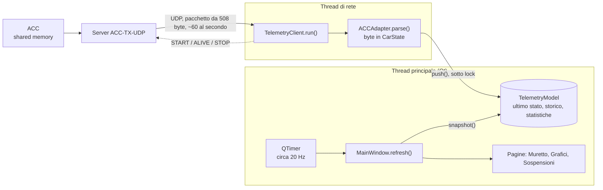

# ACC Pit Wall

Un **muretto** (pit wall) desktop per il sim racing: mostra in tempo reale gomme, freni, sospensioni, carburante, tempi e grafici di guida, a partire dai dati inviati dal server [ACC-TX-UDP](https://github.com/gabbo76/ACC-TX-UDP). È scritto in Python con PySide6 (Qt) ed è pensato per essere esteso ad altri simulatori.

> **Stato del progetto:** prototipo funzionante, provato su Windows con Python 3.14 e PySide6 6.12. Vedi la sezione [Stato di verifica e limiti](#12-stato-di-verifica-e-limiti) per sapere cosa è stato collaudato e cosa no.

## Indice

1. [Cosa fa](#1-cosa-fa)
2. [Installazione e avvio](#2-installazione-e-avvio)
3. [Primo avvio](#3-primo-avvio)
4. [Guida all'uso](#4-guida-alluso)
5. [Come funziona](#5-come-funziona)
6. [Il protocollo e il pacchetto](#6-il-protocollo-e-il-pacchetto)
7. [Il codice, file per file](#7-il-codice-file-per-file)
8. [Impostazioni](#8-impostazioni)
9. [Convenzioni e assunzioni da verificare](#9-convenzioni-e-assunzioni-da-verificare)
10. [Problemi comuni](#10-problemi-comuni)
11. [Estendere il progetto](#11-estendere-il-progetto)
12. [Stato di verifica e limiti](#12-stato-di-verifica-e-limiti)
13. [Note legali](#13-note-legali)

---

## 1. Cosa fa

L'app si collega al server ACC-TX-UDP, che legge la shared memory di Assetto Corsa Competizione e la invia via UDP, e mostra i dati in tre schermate più una finestra di diagnostica:

| Schermata | Contenuto |
|---|---|
| **Muretto** | Per ogni ruota: pressione, temperature della gomma, usura, pastiglie, disco, pressione freno e usura dalla partenza. Pannello auto con marcia, velocità, pedali, TC, ABS, brake bias e un volante che ruota. |
| **Grafici** | Acceleratore, freno, sterzo e marcia che scorrono nel tempo. Il TC e l'ABS colorano i tratti in cui intervengono. Cursore con lettura dei valori. |
| **Sospensioni** | Quattro sospensioni stilizzate che si muovono in base alla corsa. |
| **Diagnostica** (finestra) | Mostra campo per campo cosa arriva davvero dal server: valore attuale, minimo, massimo e quante volte è stato diverso da zero. |

Sopra le schermate c'è sempre l'**intestazione** con stato, sessione, bandiera, posizione, giri, tempi, carburante e giri di carburante rimasti.

## 2. Installazione e avvio

**Requisiti**

- Windows (provato). Dovrebbe avviarsi anche altrove, ma non è stato verificato.
- Python 3.10 o superiore.
- PySide6 (basta il pacchetto "Essentials").
- Il server ACC-TX-UDP in esecuzione sul PC dove gira ACC.

**Installazione**

```
py -m pip install PySide6-Essentials
```

Usa `py -m pip` e non `pip`: se sul PC hai più installazioni di Python, `pip` può installare in una e `py` avviare un'altra, con l'errore `No module named 'PySide6'`. `py -0p` elenca le installazioni.

**Avvio**

```
py acc_pitwall.py
```

**Cartella del progetto.** Tutti questi file devono stare insieme:

```
acc_pitwall.py        punto di avvio
acc_tx_client.py      rete, parsing del pacchetto, modello dati
pitwall_logic.py      logica senza grafica
pitwall_ui/           interfaccia, una pagina per file
    __init__.py
    common.py
    dashboard.py
    graphs.py
    suspension.py
    dialogs.py
    main_window.py
check_tyre_temps.py   strumento di controllo a riga di comando (facoltativo)
```

Se aggiorni i file, **sostituiscili tutti insieme**: si importano a vicenda, e una versione vecchia mescolata a una nuova causa un `ImportError`. Il punto di avvio lo segnala con un messaggio chiaro.

## 3. Primo avvio

1. Avvia il server ACC-TX-UDP e ACC.
2. Avvia l'app. Se il server è sullo stesso PC e usa la porta 9999 (il default), si collega da sola.
3. Se è su un altro PC: **Impostazioni → Connessione e soglie → Connessione**, inserisci l'IP e la porta, conferma.
4. In basso a destra la barra di stato mostra `Connesso`, il numero di pacchetti al secondo e, se ce ne sono, quanti ne sono stati scartati.
5. Se qualche valore resta a `n/d`, apri **Aiuto → Diagnostica pacchetto** (Ctrl+D) e guida qualche secondo: ti dice quali campi il server non riempie mai.

## 4. Guida all'uso

### Intestazione

Dall'alto a sinistra: **STATO** (LIVE, PAUSA, REPLAY, OFF; con asterisco `LIVE*` quando il server non valorizza lo stato ma il motore gira), **SESSIONE** (prove, qualifica, gara…), bandiera colorata, **POSIZIONE**, **GIRI**, tempo **ATTUALE**, **ULTIMO** e **MIGLIORE**, tempo **RIMASTO**, carburante (**FUEL L**), consumo medio (**L / GIRO**) e **GIRI FUEL** rimasti. Se il segnale cade, il corpo della finestra si attenua e lo stato diventa `NO SIGNAL`.

### Muretto

Quattro riquadri (anteriori in alto, posteriori in basso), uno per ruota. Ognuno ha due sezioni.

**Gomma**

| Campo | Significato |
|---|---|
| SUPERFICIE °C | temperatura di superficie |
| PRESSIONE PSI | pressione, colorata in base alla finestra ottimale |
| CORE °C | temperatura interna della gomma, colorata |
| INTERNA / CENTRO / ESTERNA | temperature sulla larghezza della gomma; `n/d` se il sim non le fornisce |
| USURA GOMMA | mostrata solo se il server la valorizza |

**Freno**

| Campo | Significato |
|---|---|
| PASTIGLIE mm | spessore residuo, colorato se imposti le soglie |
| DISCO mm | spessore residuo del disco, idem |
| MESCOLA PAST. | valore grezzo mandato dal server (anteriori e posteriori hanno una mescola ciascuno) |
| PRESS. FRENO | pressione istantanea, con una barra scalata sul massimo osservato fra le quattro ruote |
| USURA PAST. / DISCO mm | quanto si sono consumati **dall'inizio della sessione** (rispetto al primo valore valido dopo la connessione) |

Colori: verde = nella finestra ottimale, giallo = vicino ai limiti, rosso = fuori, azzurro = troppo basso/freddo, grigio = nessun dato o soglia disattivata. Le soglie di pastiglie e dischi sono **disattivate di default**: osserva i valori con pastiglie nuove e impostale tu.

La temperatura dei dischi non è nel pacchetto: il campo va aggiunto lato server.

**Pannello auto** (a destra): marcia, velocità, giri motore, barre di acceleratore e freno, brake bias, temperatura dell'acqua, indicatori TC e ABS (`ATTIVO` solo mentre intervengono), stato del motore, un **volante** che ruota con lo sterzo e il suo valore in gradi, più il **valore grezzo** del campo (utile per calibrare l'unità).

### Grafici

Quattro grafici sovrapposti: **acceleratore**, **freno**, **sterzo** (in gradi, zero al centro) e **marcia** (a gradini).

- Sull'acceleratore i tratti sono verdi e diventano **arancioni** mentre il TC interviene; sul freno sono rossi e diventano **azzurri** mentre interviene l'ABS.
- A sinistra di ogni grafico c'è il valore attuale e un'etichetta TC/ABS che si accende durante l'intervento.
- **Finestra**: 3, 5, 10, 20, 30 o 60 secondi. Per leggere come sale o scende un pedale usa le finestre corte (3–5 s); con 60 s un'accelerata di mezzo secondo sembra verticale.
- **Cursore**: passa il mouse su un grafico e compare una linea verticale su tutti e quattro, con il valore letto in quel punto.
- **Pausa grafici**: congela la vista per analizzarla. I dati continuano ad arrivare e si recuperano alla ripresa.
- Senza segnale i grafici restano fermi, così puoi rivedere gli ultimi secondi.

### Sospensioni

Quattro sospensioni McPherson stilizzate in vista frontale. La ruota resta a terra; quando la sospensione si comprime la **scocca scende**, la molla si accorcia e passa da verde a giallo a rosso avvicinandosi al fondo corsa, lo stelo dell'ammortizzatore rientra nel cilindro e il braccio inferiore si raddrizza. Le ruote di destra sono specchiate. Il movimento è ammorbidito (circa 30 fotogrammi al secondo) anche se i dati arrivano a 20 Hz.

Sotto ogni disegno: **CORSA mm** e **DANNO**. In alto a destra il pulsante **Azzera range** ricomincia la scala automatica. La riga in alto indica l'unità rilevata e se la scala è automatica o a corsa fissa.

### Menu e scorciatoie

| Menu | Voce | Scorciatoia |
|---|---|---|
| File | Connetti | Ctrl+K |
| | Disconnetti | |
| | Esci | Ctrl+Q |
| Impostazioni | Connessione e soglie… | Ctrl+, |
| Visualizza | Muretto | Ctrl+1 |
| | Grafici | Ctrl+2 |
| | Sospensioni | Ctrl+3 |
| | Schermo intero | F11 |
| | Sempre in primo piano | |
| Aiuto | Diagnostica pacchetto… | Ctrl+D |
| | Informazioni | |

### Finestra Impostazioni

Quattro schede:

- **Connessione**: simulatore, indirizzo del server, porta, intervallo `ALIVE`, frequenza di aggiornamento dello schermo, connessione automatica all'avvio. Se cambi indirizzo o porta mentre sei collegato, l'app si ricollega da sola.
- **Soglie e colori**: finestre ottimali di pressione, temperatura core e superficie, soglie di pastiglie, dischi e carburante.
- **Volante**: unità di `steerAngle` (normalizzato, gradi, radianti), rotazione per lato, inversione.
- **Sospensioni**: unità di `suspensionTravel` (automatica, metri, centimetri, millimetri), corsa totale (0 = scala automatica) e inversione.

### Diagnostica pacchetto

Finestra non modale (resta aperta mentre guidi). La tabella elenca tutti i campi del pacchetto con valore attuale, minimo, massimo e la percentuale di campioni diversi da zero. In cima, la lista dei campi che **non sono mai stati diversi da zero**: sono i candidati a essere non valorizzati dal server. Le statistiche sono calcolate a ogni pacchetto (non a ogni aggiornamento dello schermo), quindi anche un intervento brevissimo del TC viene contato. I pulsanti **Azzera statistiche** e **Copia report** servono per ricominciare e per incollare i risultati in una segnalazione.

---

## 5. Come funziona

### Panoramica

L'app ha due metà che girano in parallelo e si incontrano in un solo punto, il **modello dati**:



### Il percorso di un dato

Seguiamo la velocità, `speedKmh = 187.5`:

1. ACC scrive nella shared memory. Il server copia i valori nella struct `_packet` (508 byte) e la manda via UDP, circa 60 volte al secondo, a ogni client registrato.
2. Nel **thread di rete**, `TelemetryClient.run()` aspetta un pacchetto con `recvfrom` (timeout 0,25 s, così può fare anche altro). A ogni giro controlla se è ora di mandare `ALIVE`.
3. `ACCAdapter.parse()` verifica che i byte siano esattamente 508 e li interpreta con `RawPacket`, una `ctypes.Structure` che replica il layout C++. La velocità sta all'offset 24 (dopo gas, freno, fuel, marcia, giri e sterzo, 4 byte ciascuno) ed è un `float`. Dai campi grezzi nasce un **`CarState`**: una dataclass **immutabile** con nomi neutri; gli array per ruota diventano tuple nell'ordine anteriore sinistra, anteriore destra, posteriore sinistra, posteriore destra.
4. `model.push(state)` prende un lock, sostituisce l'ultimo stato, aggiunge un campione allo **storico** (una `deque` fino a 15.000 elementi) e aggiorna il contatore di pacchetti al secondo. `model.record()` aggiorna le statistiche per campo della diagnostica.
5. Il thread di rete torna ad aspettare. Non sa nulla della grafica.

### Come si aggiorna la UI

In `MainWindow` c'è un `QTimer` impostato a `1000 / refresh_hz` (default 50 ms). Ogni scatto, nel thread principale, chiama `refresh()`:

1. `model.snapshot()` prende sotto lock l'ultimo `CarState`. Non lo copia, perché è immutabile: basta il riferimento. Calcola anche da quanto tempo non arriva un pacchetto: oltre 3 secondi, `connected` diventa falso. "NO SIGNAL" non è un evento, viene ricalcolato a ogni scatto.
2. Se non c'è connessione il corpo si attenua (effetto di opacità); se c'è, si aggiorna il consumo carburante e si chiamano `refresh_from` / `refresh` su intestazione e pagine.
3. Ogni widget trasforma i numeri in testo e in un **livello** di colore (`classify_window`, `classify_life`) e chiama `Metric.set(testo, livello)`. Se testo e livello sono identici all'ultima volta, `Metric.set` esce subito: niente `setText` né `setStyleSheet` inutili.
4. Le pagine **Grafici** e **Sospensioni** si aggiornano solo quando sono la scheda visibile, per non consumare CPU inutilmente.

Dei circa 60 stati al secondo, la dashboard ne vede circa 20: gli altri vengono scartati *per la visualizzazione*, ma restano nello **storico** (per i grafici) e nelle **statistiche** (per la diagnostica).

### Thread e sicurezza dei dati

| Thread | Cosa fa |
|---|---|
| **Principale (Qt)** | Interfaccia, timer, disegno. È l'unico che tocca i widget. |
| **`telemetry-rx`** | Rete: START, ALIVE, STOP, ricezione, parsing, scrittura nel modello. |

- Il modello è l'unico punto di contatto, protetto da un `threading.Lock`.
- `CarState` è immutabile: il lock protegge solo lo scambio del riferimento, quindi il thread di rete non resta mai fermo ad aspettare la grafica.
- Un `Thread` non può essere riavviato: a ogni (ri)connessione si crea un nuovo client con un nuovo modello.

### Keepalive e riconnessione

Il server scollega i client dopo 30 secondi senza `ALIVE`. Il client:

- manda `START` all'inizio e `ALIVE` ogni `alive_interval` secondi (default 10);
- se non riceve nulla per 5 secondi rimanda `START` (al massimo uno ogni 2 secondi), per ritrovare un server riavviato;
- manda `STOP` quando si chiude;
- ignora gli errori di rete transitori (su Windows un `ConnectionResetError` arriva quando il server non è in ascolto).

### I grafici in dettaglio

Ridisegnare un grafico ricostruendo tutti i punti a ogni scatto costa molto. Qui il lavoro è diviso così:

- **`ChunkedSeries`** (in `pitwall_logic.py`) conserva ogni serie in **blocchi da circa 1 secondo**. A ogni scatto si aggiungono **solo i campioni nuovi** (`model.history_since()`), non si ricopia tutta la finestra.
- Un blocco ha un solo *flag* (TC attivo, ABS attivo…): cambiando flag ne parte uno nuovo, che inizia dall'ultimo punto del precedente, quindi la linea non ha buchi. È così che i tratti cambiano colore.
- I **tratti piatti** (valore invariato) vengono compressi: si allunga l'ultimo punto invece di aggiungerne. Gli eventi brevi e le rampe graduali restano intatti.
- `TraceWidget` costruisce per ogni blocco un `QPainterPath` in **coordinate dati** (tempo, valore) e lo conserva. Un blocco già chiuso non si ricostruisce più; solo quello in corso viene rifatto.
- Per mostrare tutto, il painter applica una **trasformazione** (scala e traslazione) che porta tempo e valore in pixel. Il pennello è *cosmetico*, quindi lo spessore resta di 2 pixel anche con la scala. A ogni fotogramma non si ricalcola nessun punto, e Qt gestisce il resto in codice nativo.
- Le **marce** sono a gradini: a ogni cambio si inseriscono due punti allo stesso istante (marcia vecchia, poi nuova).
- Il **cursore** usa `value_at()` per leggere il valore al tempo del mouse (interpolato, oppure l'ultimo noto per le marce).

Nelle misure fatte in sviluppo (solo la parte Python, con un finto pennello), il lavoro per ogni scatto è passato da circa 9–25 ms a circa 0,4–0,8 ms, a seconda della finestra e della frequenza dei dati. Il costo del disegno nativo di Qt non è stato misurato.

### Le sospensioni

La corsa arriva come valore grezzo per ruota. `resolve_susp_unit` lo converte in millimetri (in modalità automatica, se compare un valore pari o superiore a 1 non può essere in metri). `TravelTracker` lo normalizza da 0 (estesa) a 1 (compressa a fondo corsa): con la corsa totale impostata si usa quella, altrimenti il minimo e il massimo osservati dall'ultimo azzeramento. `SuspensionWidget` disegna tutto in un'area logica di 260 × 220 unità, scalata per stare nel riquadro, quindi le proporzioni non dipendono dalla dimensione della finestra. Un timer a 33 ms (attivo solo quando la pagina è visibile) avvicina il valore mostrato a quello reale per ammorbidire il movimento.

### I freni

`BrakeTracker` ricorda il primo spessore valido di pastiglie e dischi dopo la connessione, per calcolare l'**usura dalla partenza**, e il massimo di pressione freno osservato, per scalare la barra. Si azzera a ogni nuova connessione.

### Il carburante

Il campo `fuelXLap` del server è un `int` e quindi troncato: **non viene usato**. `FuelTracker` misura da solo quanto carburante scende tra un giro completato e il successivo e fa la media degli ultimi tre giri validi. Scarta il primo giro (si entra a metà), i giri con rifornimento (un aumento oltre 0,3 L) e i giri saltati. Funziona solo in pista (stato LIVE, oppure `status` a 0 con motore in moto).

---

## 6. Il protocollo e il pacchetto

**Messaggi UDP** (tutti sulla stessa porta del server, dallo stesso socket):

| Messaggio | Direzione | Significato |
|---|---|---|
| `START` | client → server | registrazione: il server comincia a mandare i dati |
| `ALIVE` | client → server | resto in vita; senza `ALIVE` per 30 s il server scollega |
| `STOP` | client → server | disconnessione |
| *pacchetto di dati* | server → client | struct binaria di 508 byte, alla frequenza configurata nel server |

**Layout del pacchetto.** Little-endian, allineamento a 4 byte, generato dalla struct `RawPacket` di `acc_tx_client.py`. Il client **scarta ogni pacchetto che non è lungo esattamente 508 byte** e lo conta fra gli "scartati" nella barra di stato. Gli array hanno 4 elementi, nell'ordine ruote **anteriore sinistra, anteriore destra, posteriore sinistra, posteriore destra**.

| Offset | Byte | Campo | Tipo | Note |
|---:|---:|---|---|---|
| 0 | 4 | `gas` | float | acceleratore 0..1 |
| 4 | 4 | `brake` | float | freno 0..1 |
| 8 | 4 | `fuel` | float | carburante, litri |
| 12 | 4 | `gear` | int32 | **-1 = R, 0 = N, 1.. = marce** (convenzione del server) |
| 16 | 4 | `rpm` | int32 | giri motore |
| 20 | 4 | `steerAngle` | float | normalizzato **-1..+1** (fondo scala sx/dx); positivo = destra |
| 24 | 4 | `speedKmh` | float | km/h |
| 28 | 12 | `accG` | float[3] | decodificato, non mostrato (solo Diagnostica) |
| 40 | 16 | `wheelSlip` | float[4] | decodificato, non mostrato |
| 56 | 16 | `wheelLoad` | float[4] | decodificato, non mostrato |
| 72 | 16 | `wheelsPressure` | float[4] | pressione gomme, **PSI** |
| 88 | 16 | `wheelAngularSpeed` | float[4] | decodificato, non mostrato |
| 104 | 16 | `tyreWear` | float[4] | mostrato come "USURA GOMMA" solo se non e' tutto a zero; scala non verificata |
| 120 | 16 | `tyreDirtyLevel` | float[4] | decodificato, non mostrato |
| 136 | 16 | `tyreCoreTemperature` | float[4] | temperatura core gomma, °C |
| 152 | 16 | `camberRAD` | float[4] | decodificato, non mostrato |
| 168 | 16 | `suspensionTravel` | float[4] | corsa sospensioni; nelle prove arriva in **mm** (rilevamento automatico dell'unita') |
| 184 | 16 | `tyreTempI` | float[4] | temperatura gomma interna; **nelle prove sempre 0** -> "n/d" |
| 200 | 16 | `tyreTempM` | float[4] | temperatura gomma centro; nelle prove sempre 0 -> "n/d" |
| 216 | 16 | `tyreTempO` | float[4] | temperatura gomma esterna; nelle prove sempre 0 -> "n/d" |
| 232 | 4 | `brakeBias` | float | frazione (0..1) o percentuale: l'interfaccia mostra sempre % |
| 236 | 4 | `tcinAction` | int32 | TC sta intervenendo (0/1) |
| 240 | 4 | `absInAction` | int32 | ABS sta intervenendo (0/1) |
| 244 | 16 | `suspensionDamage` | float[4] | danno alla sospensione; si assume scala 0..1 |
| 260 | 16 | `tyreTemp` | float[4] | temperatura di **superficie** della gomma, °C |
| 276 | 4 | `waterTemp` | float | acqua, °C |
| 280 | 16 | `brakePressure` | float[4] | decodificato, non mostrato |
| 296 | 4 | `frontBrakeCompound` | int32 | decodificato, non mostrato |
| 300 | 4 | `rearBrakeCompound` | int32 | decodificato, non mostrato |
| 304 | 16 | `padLife` | float[4] | spessore pastiglie, mm |
| 320 | 16 | `discLife` | float[4] | spessore dischi, mm |
| 336 | 4 | `ignitionOn` | int32 | decodificato (solo Diagnostica) |
| 340 | 4 | `starterEngineOn` | int32 | decodificato (solo Diagnostica) |
| 344 | 4 | `isEngineRunning` | int32 | nelle prove **non valorizzato** dal server: il motore e' dedotto dai giri |
| 348 | 4 | `status` | int32 | 0 OFF, 1 REPLAY, 2 LIVE, 3 PAUSA |
| 352 | 4 | `session` | int32 | vedi tabella sessioni |
| 356 | 30 | `currentTime` | wchar_t[15] | stringa UTF-16 (`wchar_t[15]`); l'interfaccia preferisce i millisecondi |
| 386 | 30 | `lastTime` | wchar_t[15] | idem |
| 416 | 30 | `bestTime` | wchar_t[15] | idem |
| 446 | 30 | `split` | wchar_t[15] | decodificato, non mostrato |
| 476 | 4 | `completedLaps` | int32 | giri completati |
| 480 | 4 | `position` | int32 | posizione in gara |
| 484 | 4 | `iCurrentTime` | int32 | tempo giro attuale, ms |
| 488 | 4 | `iLastTime` | int32 | ultimo giro, ms |
| 492 | 4 | `iBestTime` | int32 | miglior giro, ms (2147483647 = nessun tempo) |
| 496 | 4 | `sessionTimeLeft` | float | tempo di sessione rimasto; **si assume in millisecondi** |
| 500 | 4 | `flag` | int32 | vedi tabella bandiere |
| 504 | 4 | `fuelXLap` | int32 | `int`, quindi troncato: **non viene usato** (il consumo e' calcolato dall'app) |

**Stato** (`status`)

| Valore | Significato |
|---:|---|
| 0 | OFF |
| 1 | REPLAY |
| 2 | LIVE |
| 3 | PAUSA |

**Sessione** (`session`)

| Valore | Significato |
|---:|---|
| -1 | sconosciuta |
| 0 | prove |
| 1 | qualifica |
| 2 | gara |
| 3 | hotlap |
| 4 | time attack |
| 5 | drift |
| 6 | drag |
| 7 | hotstint |
| 8 | hotlap superpole |

**Bandiere** (`flag`)

| Valore | Bandiera | Valore | Bandiera |
|---:|---|---:|---|
| 0 | nessuna | 5 | scacchi |
| 1 | blu | 6 | penalità |
| 2 | gialla | 7 | verde |
| 3 | nera | 8 | arancione |
| 4 | bianca | | |

Queste tre tabelle seguono le costanti dell'SDK di Kunos (le sessioni coincidono con quelle usate dal server). Se vedi un'etichetta sbagliata, correggi `STATUS_NAMES`, `SESSION_NAMES` e `FLAG_NAMES` in `pitwall_logic.py`.

---

## 7. Il codice, file per file

### `acc_pitwall.py`: avvio

Poche righe: importa `pitwall_ui.main_window.main` e lo esegue. Se manca PySide6, se mancano file del progetto o se le versioni dei file non coincidono, stampa un messaggio con la soluzione invece di un errore criptico.

### `acc_tx_client.py`: rete e dati

| Elemento | Compito |
|---|---|
| `RawPacket` | `ctypes.Structure` che replica la struct del server; un `assert` sulla dimensione (508 byte) segnala subito un layout diverso |
| `flatten_raw` | trasforma il pacchetto in un dizionario `nome → valore` (gli array diventano `nome[i]`), per la diagnostica |
| `FieldStats` | per ogni campo tiene ultimo valore, minimo, massimo e quante volte è stato diverso da zero |
| `CarState` | dataclass immutabile, con nomi neutri rispetto al simulatore: è l'unico dato che la grafica conosce |
| `ACCAdapter` | traduce `RawPacket` in `CarState` (`parse`) e in dizionario piatto (`flatten`) |
| `TelemetryModel` | ultimo stato, storico, statistiche e conteggi, protetti da un lock. Metodi: `push`, `push_bad`, `snapshot`, `history`, `history_since`, `record`, `stats_snapshot`, `stats_reset` |
| `Snapshot` | fotografia immutabile: stato, connesso o no, età dell'ultimo pacchetto, pacchetti al secondo, scartati |
| `TelemetryClient` | il thread di rete: START, ALIVE, STOP, riconnessione, ricezione e parsing |

Lo storico contiene tuple `(tempo, gas, freno, sterzo, tc, abs, marcia)` per ogni pacchetto.

### `pitwall_logic.py`: logica senza grafica

Non importa Qt: si può testare da sola.

| Elemento | Compito |
|---|---|
| `AppSettings`, `load_settings`, `save_settings`, `settings_path` | impostazioni in JSON, con validazione e migrazione tra versioni |
| `classify_window`, `classify_life` | trasformano un valore in un livello (`ok`, `warn`, `crit`, `low`, `na`) |
| `FuelTracker` | consumo medio e giri di carburante rimasti |
| `steer_to_degrees`, `steer_out_of_range` | conversione e controllo dello sterzo |
| `travel_to_mm`, `resolve_susp_unit`, `TravelTracker` | unità e normalizzazione della corsa delle sospensioni |
| `Chunk`, `ChunkedSeries` | serie temporali a blocchi per i grafici |
| `BrakeTracker` | usura di pastiglie e dischi dalla partenza, scala della pressione freno |
| `gear_name`, `fmt_ms`, `fmt_lap`, `fmt_clock_ms`, `status_name`, `session_name`, `is_live` | formattazione e deduzioni |
| `STATUS_NAMES`, `SESSION_NAMES`, `FLAG_NAMES`, `LEVEL_COLORS` | tabelle e colori |

### `pitwall_ui/`: interfaccia, una pagina per file

| File | Contenuto |
|---|---|
| `common.py` | costanti, stile (QSS), `Metric` (didascalia + valore colorato, ridisegnato solo se cambia), `FlagLabel`, `hline`, `fmt_or_dash` |
| `dashboard.py` | `TyreCard` (gomma + freno), `HeaderPanel`, `SteeringWheel`, `CarPanel`, `DashboardPage` |
| `graphs.py` | `TraceWidget` (il grafico), `GraphPanel`, `GraphPage` |
| `suspension.py` | `SuspensionWidget` (il disegno), `SuspensionCard`, `SuspensionPage` |
| `dialogs.py` | `SettingsDialog`, `DiagnosticsDialog` |
| `main_window.py` | `MainWindow` (menu, schede, barra di stato, timer, connessione), `main()` |

Ogni pagina espone due cose semplici: `refresh(...)` che riceve i dati e aggiorna i widget, e (dove serve) `reset()` per ricominciare da zero a ogni nuova connessione.

### `check_tyre_temps.py`: controllo a riga di comando

Legge dal server e stampa i valori grezzi delle temperature gomma per qualche secondo, senza usare l'interfaccia, e dice alla fine quali campi non sono mai stati diversi da zero. Utile per distinguere "il server manda zero" da "l'interfaccia le nasconde".

```
py check_tyre_temps.py --host 127.0.0.1 --port 9999 --seconds 20
```

---

## 8. Impostazioni

Sono salvate in `%APPDATA%\ACC-PitWall\settings.json` (su altri sistemi, `~/.config/ACC-PitWall/settings.json`) e si possono modificare dal menu. Il file è tollerante: valori corrotti tornano al default, chiavi sconosciute vengono ignorate, i limiti vengono riportati nell'intervallo valido.

| Chiave | Default | Significato |
|---|---|---|
| `sim` | `'ACC'` | Simulatore (oggi solo `ACC`). |
| `host` | `'127.0.0.1'` | IP o nome del PC dove gira il server ACC-TX-UDP. |
| `port` | `9999` | Porta UDP del server. |
| `alive_interval` | `10.0` | Ogni quanti secondi si invia `ALIVE` (il server scollega a 30 s; limite 2-25). |
| `auto_connect` | `True` | Collegarsi da soli all'avvio. |
| `refresh_hz` | `20` | Frequenza di aggiornamento dello schermo (5-60 Hz). |
| `always_on_top` | `False` | Finestra sempre in primo piano. |
| `geometry` | `''` | Posizione e dimensione finestra (interno). |
| `settings_version` | `2` | Versione del file, per le migrazioni (interno). |
| `steer_unit` | `'norm'` | Unita' di `steerAngle`: `norm`, `deg`, `rad`. |
| `steer_max_deg` | `270.0` | Rotazione per lato a fondo scala (solo `norm`). |
| `steer_invert` | `False` | Inverte il senso di rotazione del volante grafico. |
| `graph_seconds` | `20` | Finestra dei grafici (2-120 s; dal menu a tendina 3/5/10/20/30/60). |
| `susp_unit` | `'auto'` | Unita' di `suspensionTravel`: `auto`, `m`, `cm`, `mm`. |
| `susp_range_mm` | `0.0` | Corsa totale; 0 = scala automatica. |
| `susp_invert` | `False` | Inverte il verso della compressione. |
| `p_lo` | `26.8` | Pressione ottimale, minimo (PSI). |
| `p_hi` | `27.8` | Pressione ottimale, massimo (PSI). |
| `p_margin` | `1.0` | Fascia gialla oltre i limiti (PSI). |
| `core_lo` | `75.0` | Core gomma ottimale, minimo (°C). |
| `core_hi` | `95.0` | Core gomma ottimale, massimo (°C). |
| `core_margin` | `10.0` | Fascia gialla (°C). |
| `surf_lo` | `80.0` | Superficie gomma ottimale, minimo (°C). |
| `surf_hi` | `100.0` | Superficie gomma ottimale, massimo (°C). |
| `surf_margin` | `10.0` | Fascia gialla (°C). |
| `pad_warn` | `0.0` | Pastiglie: giallo sotto questo spessore (mm). 0 = disattivato. |
| `pad_crit` | `0.0` | Pastiglie: rosso sotto (mm). 0 = disattivato. |
| `disc_warn` | `0.0` | Dischi: giallo sotto (mm). 0 = disattivato. |
| `disc_crit` | `0.0` | Dischi: rosso sotto (mm). 0 = disattivato. |
| `fuel_laps_warn` | `5.0` | Carburante: giallo sotto questi giri rimasti. |
| `fuel_laps_crit` | `2.0` | Carburante: rosso sotto questi giri rimasti. |

**Migrazione.** Il campo `settings_version` permette di correggere file salvati da versioni precedenti. Per esempio, un file senza versione che contiene `susp_unit = "m"` (che allora era il default, non una scelta) viene portato su `auto`.

---

## 9. Convenzioni e assunzioni da verificare

**Convenzioni usate**

- Ordine delle ruote negli array: anteriore sinistra, anteriore destra, posteriore sinistra, posteriore destra.
- Marce nella convenzione del server: -1 = R, 0 = N, 1… = marce.
- Sterzo: positivo = destra; il campo è normalizzato da -1 a +1 (fondo scala).
- Pressione gomme in PSI, temperature in °C, spessori freni in mm.

**Assunzioni non verificate** (se qualcosa non torna, partire da qui)

| Cosa | Assunzione | Come verificarla |
|---|---|---|
| `sessionTimeLeft` | millisecondi | confronta con il tempo rimasto in gioco |
| `suspensionDamage` | scala 0..1, mostrata in percentuale | guarda i valori nella Diagnostica |
| `brakeBias` | frazione o percentuale; mostrato sempre in % | confronta con il valore in gioco |
| `tyreWear` | scala non nota; se tutto zero, "n/d" | Diagnostica |
| mescola pastiglie | mostrata come numero grezzo | confronta con la scelta in gioco |
| unità `suspensionTravel` | rilevata in automatico | scheda Sospensioni |
| soglie di pressione e temperatura | valori di partenza generici | adattale alla tua auto e mescola |

**Deduzioni dell'app** quando il server non valorizza un campo: il motore è considerato acceso se `isEngineRunning` è 1 **oppure** i giri sono almeno 400; lo stato è LIVE (con asterisco) se `status` è 0 ma i giri sono almeno 400; i tempi sul giro si ricavano dai millisecondi (`iCurrentTime`…) e la stringa del server è solo un ripiego.

---

## 10. Problemi comuni

| Sintomo | Causa probabile e rimedio |
|---|---|
| `No module named 'PySide6'` | PySide6 è installato in un altro Python. Usa `py -m pip install PySide6-Essentials` e avvia con `py`. `py -0p` elenca le installazioni. |
| `ImportError: cannot import name …` | I file non sono della stessa versione. Sostituiscili tutti insieme, compresa la cartella `pitwall_ui`. |
| `Manca il modulo 'pitwall_ui'` | Manca la cartella `pitwall_ui` accanto a `acc_pitwall.py`. |
| `NO SIGNAL` | Server spento, IP o porta sbagliati, firewall che blocca UDP, oppure il server non ha ricevuto lo `START`. |
| "scartati: N" nella barra di stato | I pacchetti hanno una lunghezza diversa da 508 byte: il layout del server è cambiato. Aggiorna `RawPacket` (e l'`assert`) in `acc_tx_client.py`. |
| Un valore resta `n/d` o a zero | Apri la Diagnostica o lancia `check_tyre_temps.py`: se il campo non è mai diverso da zero, non lo riempie il server (o il gioco non lo fornisce). |
| Le temperature interna/centro/esterna sono `n/d` | Nelle prove risultano sempre zero: probabilmente ACC non le fornisce. Restano disponibili core e superficie. |
| Il volante grafico è girato a 270° da dritto | Guarda il **valore grezzo** accanto: se esce dall'intervallo -1…+1 l'unità è diversa. Impostala nella scheda Volante. |
| Le sospensioni mostrano una corsa enorme (per esempio 27000 mm) | Unità sbagliata: scegli *Automatico* o *Millimetri* nella scheda Sospensioni. |
| La scocca delle sospensioni sale quando dovrebbe scendere | Spunta *Inverti* nella scheda Sospensioni. |
| I grafici sembrano fare solo 0 e 100 | Prova una finestra corta (3–5 s) e il cursore: leggi i valori nel punto. Se anche così il campo vale solo 0 o 1, è il dato in ingresso (per esempio una tastiera) e non il disegno. |
| Errore `Error calling Python override of QFrame::metric()` | Un attributo di un widget ha lo stesso nome di un metodo di Qt. Va rinominato (è già successo con `metric` e `pos`). |

---

## 11. Estendere il progetto

**Aggiungere un campo al pacchetto**

1. Aggiungilo alla struct `_packet` del server, nella posizione voluta.
2. Aggiungilo a `RawPacket._fields_` in `acc_tx_client.py`, **nello stesso ordine e con lo stesso tipo**, e aggiorna l'`assert` sulla dimensione.
3. Aggiungi il campo a `CarState` e valorizzalo in `ACCAdapter.parse`.
4. Mostralo in un widget (`refresh_from` della pagina interessata). Per un colore con soglie, aggiungi la soglia in `AppSettings` e nella scheda Soglie.

**Supportare un altro simulatore**

1. Scrivi un adapter con `parse(data) -> CarState` (e, se vuoi la diagnostica, `flatten(data) -> dict`). Ogni campo non fornito dal sim resta a zero: la grafica mostra `n/d`.
2. Registralo in `SIMS` (`pitwall_ui/common.py`): comparirà nel menu della scheda Connessione.
3. Se il sim ha un protocollo di connessione diverso, estendi `TelemetryClient` o scrivine uno specifico.

**Aggiungere una pagina**

1. Crea `pitwall_ui/nuova_pagina.py` con una classe `QWidget` che espone `refresh(s: CarState, cfg: AppSettings)` e, se serve, `reset()`.
2. In `main_window.py` creala in `_build_ui`, aggiungila alle schede con `addTab`, aggiungi la voce di menu e le due righe in `refresh()` che la aggiornano quando è visibile. Lo stesso in `connect_server()` per il `reset()`.

**Evitare un errore ricorrente.** Non dare ai propri attributi i nomi di metodi di Qt (`metric`, `pos`, `size`, `update`, `show`…): nasconderebbero il metodo e Qt fallirebbe quando prova a chiamarlo.

---

## 12. Stato di verifica e limiti

**Cosa è stato collaudato**

- La logica (soglie, carburante, serie dei grafici, tracker, impostazioni, parsing del pacchetto, client di rete) è stata verificata con script automatici durante lo sviluppo, contro un server UDP simulato. Gli script **non sono inclusi** in questo progetto.
- Le pagine sono state provate con un finto PySide6 che registra le chiamate di disegno, e il disegno dei grafici e delle sospensioni è stato controllato con un'anteprima ottenuta rieseguendo il vero codice con un pennello finto. Questo scova errori di logica e di geometria, ma **non sostituisce una prova su schermo reale**.
- Su Windows, con ACC, Python 3.14 e PySide6 6.12, l'app è stata avviata e usata fino alla versione precedente alla divisione in file. Le ultime modifiche (sezione freni nei riquadri, nuova struttura a pacchetto, grafici incrementali con cursore) **vanno ancora collaudate su schermo reale**.

**Limiti noti**

- Un solo server alla volta; nessuna autenticazione (adatto a una rete locale).
- Il tempo di ogni campione è l'ora di arrivo sul PC, non quella del server: il jitter di rete finisce nei grafici.
- Il pacchetto non contiene temperature dei freni, meteo, danni alla carrozzeria, stato dei box né impostazioni dell'auto (livello TC/ABS, mappa motore).
- Nessuna registrazione dei dati su disco né replay.
- Le soglie sono globali, non per auto o mescola.
- I riquadri ruota con la sezione freni sono più alti di prima: su schermi molto bassi la finestra può risultare alta.

**Idee per il futuro**: header nel pacchetto (versione, simulatore, numero di sequenza, timestamp del server); registratore e replay; test automatici inclusi nel progetto; classifica e distacchi tramite la broadcasting API; profili per auto e mescola; backend separato dai client per più postazioni.

---

## 13. Note legali

Questo non è consulenza legale.

- **Marchi.** "Assetto Corsa" e il relativo logo sono marchi di Kunos Simulazioni. Evita di usarli nel nome di un prodotto.
- **Termini d'uso.** Se pensi di distribuire o vendere il programma, controlla le condizioni di Kunos per l'uso commerciale dei dati e dei loro strumenti, e chiedi per iscritto se hai dubbi.
- **Licenze delle librerie.** PySide6 è distribuito con licenza LGPL v3 (esiste anche un'edizione commerciale di Qt per Python): leggi i requisiti prima di distribuire un'applicazione chiusa.
- **Il server.** ACC-TX-UDP è un progetto separato: controlla la sua licenza prima di distribuirlo insieme a questo.
